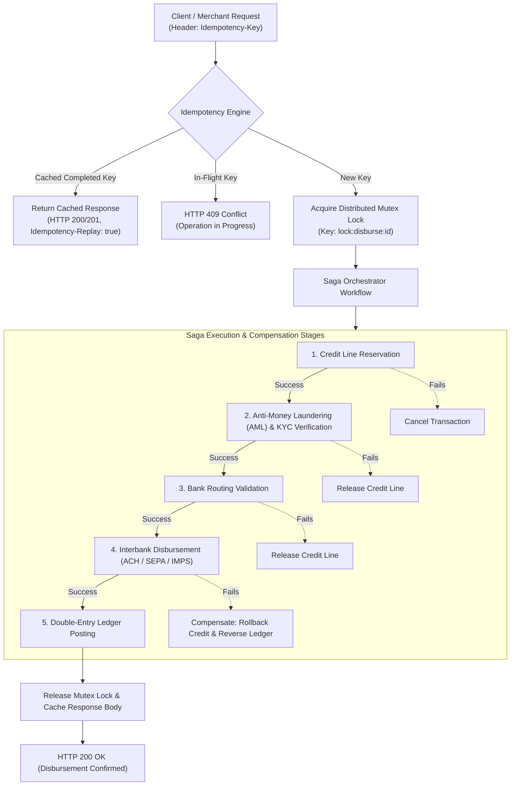

# Idempotent FinTech Payment & Loan Disbursement Pipeline

An enterprise-grade, distributed FinTech pipeline engineered for **zero duplicate debits**, **eventual consistency across microservices**, and **cryptographically verifiable double-entry bookkeeping**.

---

## 🏛️ System Architecture



---

## 💡 Core Engineering Problems Solved

### 1. Eliminating Duplicate Financial Transactions via Idempotency
- **Problem**: Network timeouts during loan disbursements cause clients to retry requests. Without strict idempotency, retried network packets result in double loan disbursements or multiple customer debits.
- **Solution**: The `IdempotencyEngine` hashes the incoming payload and idempotency key into a distributed lock table. In-flight requests are protected by a distributed mutex lock. Once completed, responses are cached with cryptographic hashes so identical retries receive the exact original result without re-executing funds movement.

### 2. Distributed Saga Orchestration with Compensating Transactions
- **Problem**: In a microservice ecosystem, operations span multiple independent database boundaries (Credit Service, Risk Service, Core Banking Gateway). A two-phase commit (2PC) blocks databases and creates single points of failure.
- **Solution**: We implement an **Orchestrated Saga Pattern**. If an interbank transfer fails at step 4, the orchestrator triggers backwards-compensating transactions (e.g. releasing previously reserved credit quotas and updating transaction status to `FAILED`).

### 3. Double-Entry Bookkeeping Ledger
- In strict adherence to financial accounting standards, funds can never be created or destroyed. Every disbursement writes balanced **Debit** and **Credit** ledger entries ($\sum \text{Debits} = \sum \text{Credits}$), providing mathematical guarantees against ledger drift or balance leakage.

---

## 📁 Project Structure

```
fintech-disbursement-pipeline/
├── src/
│   ├── idempotency/
│   │   └── IdempotencyEngine.ts    # Redis-backed distributed lock & cache manager
│   ├── saga/
│   │   ├── SagaOrchestrator.ts     # Forward execution & compensation rollback
│   │   └── steps/                  # Discrete financial stages
│   ├── ledger/
│   │   └── DoubleEntryLedger.ts    # Debit-Credit immutable ledger accountant
│   ├── scripts/
│   │   └── simulate_disbursement.ts # Concurrency & duplicate-attack test suite
│   └── index.ts                    # Pipeline demo entrypoint
├── package.json
├── tsconfig.json
└── README.md
```

---

## 🛠️ Setup & Execution

### 1. Installation
```bash
npm install
```

### 2. Start Pipeline Demonstration
```bash
npm start
```
Executes a disbursement transaction through credit reservation, KYC verification, interbank settlement, and double-entry ledger posting.

### 3. Run Concurrency & Idempotency Attack Simulation
```bash
npm run sim
```
*Simulates simultaneous duplicate network retries with identical idempotency keys, verifies that exactly one transaction executes, and triggers automated Saga compensation rollback on injected bank API failures.*
